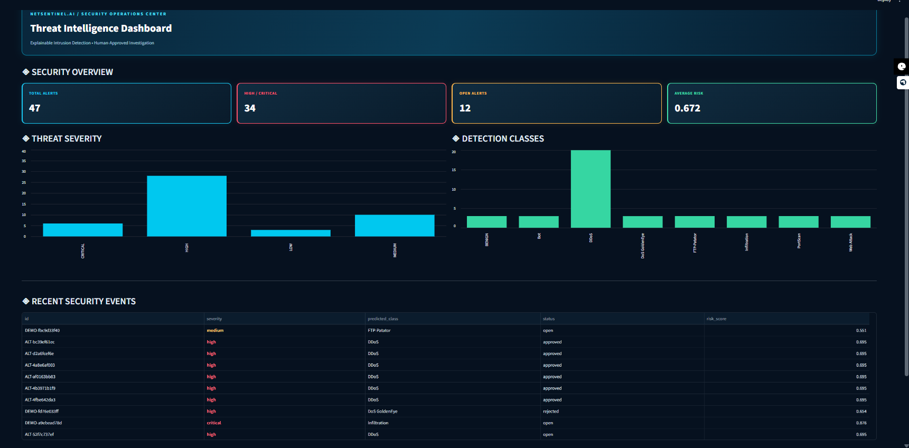
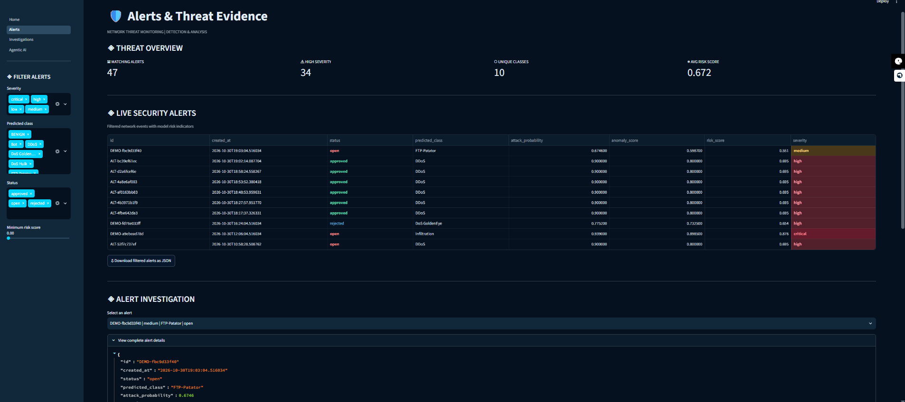
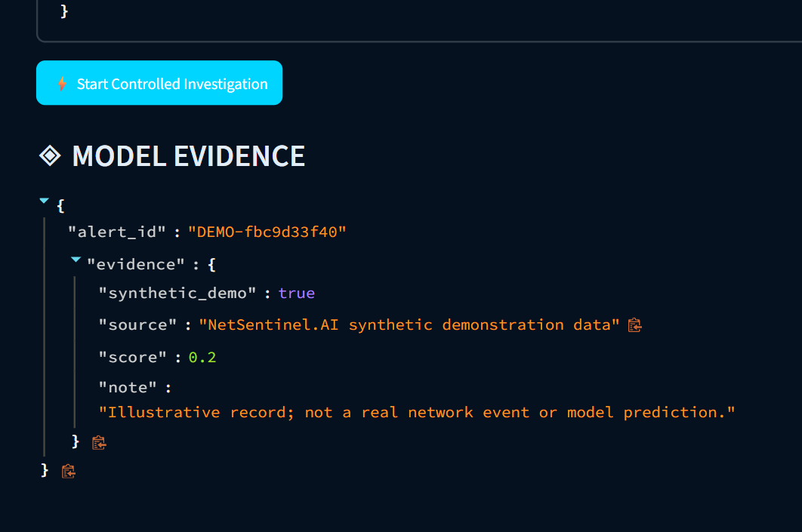
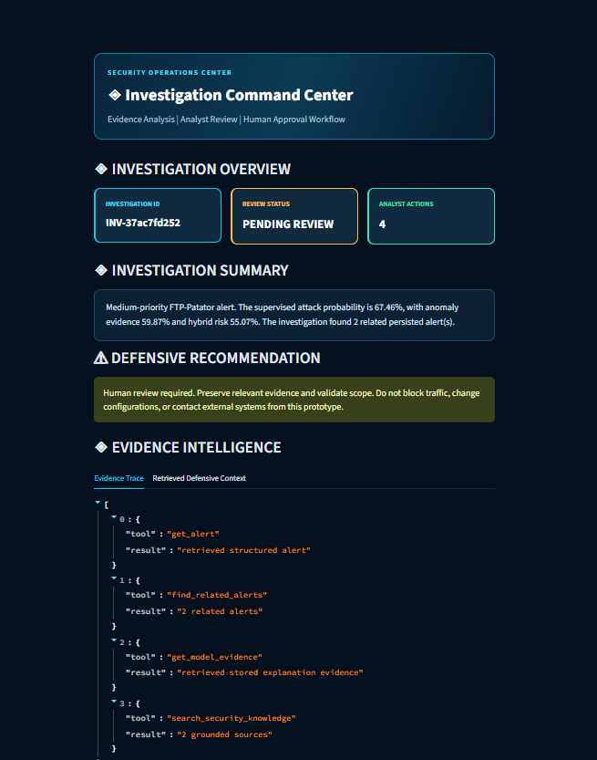
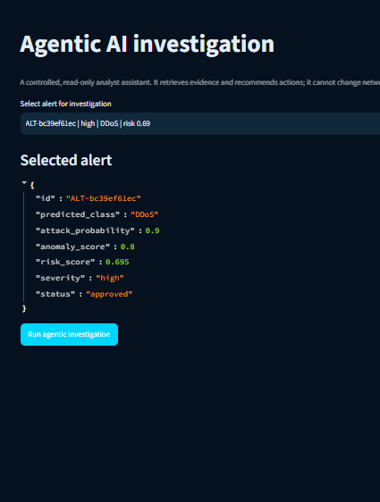
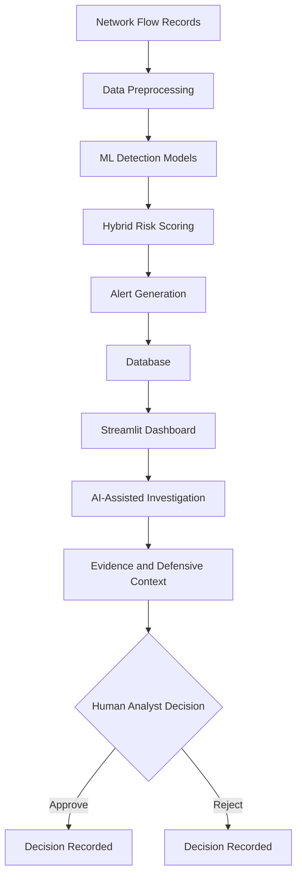

 <div align="center">

# NetSentinel.AI

### Explainable Network Intrusion Detection & Human-Guided Incident Investigation

**Detect suspicious network flows. Understand why they were flagged. Keep response decisions in human hands.**


</div>

---

## Project Overview

NetSentinel.AI is a defensive cybersecurity application designed to analyze network-flow records and identify potentially malicious activity.

It combines machine learning-based intrusion detection, anomaly detection, hybrid risk scoring, explainable evidence, and AI-assisted security investigation in one platform.

Instead of simply flagging suspicious traffic, NetSentinel.AI helps security analysts understand alerts, inspect supporting evidence, review defensive context, and make informed decisions.

**Core principle:** Detection is automated; response decisions remain under human control.

> **Safety boundary:** NetSentinel.AI is an analyst-assistance prototype. It does not automatically block traffic, modify firewall rules, change network configurations, or execute containment actions.

## Product Walkthrough

The screenshots below demonstrate the application's main workflow. Some visible alert records are synthetic demonstration data, not real network telemetry or measured model-performance results.

### 1. Security Operations Dashboard



Monitor alert volume, threat severity, detection classes, risk indicators, and recent security events.

### 2. Alerts & Threat Evidence



Filter security alerts by severity, predicted class, status, and risk score. Inspect individual alert details and supporting indicators.

### 3. Investigation & Model Evidence



Start a controlled investigation and inspect the evidence associated with a selected alert.

### 4. Investigation Summary



Review the investigation summary, defensive recommendations, evidence trace, and suggested analyst actions.

### 5. Agentic AI Investigation



Use the read-only investigation assistant to retrieve evidence and prepare recommendations for analyst review.

---

## Key Features

| Feature | Description |
|---|---|
| Network Intrusion Detection | Analyzes network-flow records to identify suspicious activity. |
| Machine Learning Detection | Uses Random Forest and XGBoost supervised models. |
| Anomaly Detection | Uses Isolation Forest to identify unusual network behavior. |
| Hybrid Risk Scoring | Combines detection and anomaly signals into risk scores and severity levels. |
| Explainable Evidence | Provides feature-level evidence to support alert analysis. |
| AI-Assisted Investigation | Retrieves defensive knowledge and prepares investigation summaries. |
| Human Approval Workflow | Allows analysts to approve or reject recommendations. |
| Security Dashboard | Displays alerts, severity distribution, detection classes, and risk indicators. |
| Persistent Storage | Stores alerts, investigations, and analyst decisions. |
| REST API | Provides backend functionality through FastAPI. |

## System Architecture



### Investigation Workflow

1. Network-flow records are prepared for analysis.
2. Detection models generate classification and anomaly signals.
3. A hybrid risk score prioritizes suspicious activity.
4. Alerts are stored and displayed in the dashboard.
5. The investigation assistant retrieves supporting evidence and defensive knowledge.
6. Recommendations are presented to the analyst.
7. The analyst approves or rejects the recommendation.

---

## Technology Stack

| Category | Technologies |
|---|---|
| Programming Language | Python 3.12 |
| Machine Learning | Scikit-learn, XGBoost |
| Anomaly Detection | Isolation Forest |
| Explainability | SHAP-compatible feature evidence |
| Backend | FastAPI, Uvicorn, Pydantic |
| Frontend | Streamlit |
| Database | SQLAlchemy, SQLite, PostgreSQL |
| Data Processing | Pandas, NumPy |
| Containerization | Docker, Docker Compose |
| Testing | Pytest, HTTPX |

## Project Structure

```text
NetSentinel.AI/
│
├── app/
│   ├── api/              # FastAPI backend
│   ├── dashboard/        # Streamlit dashboard
│   ├── detection/        # ML inference and risk scoring
│   ├── agents.py         # Investigation assistance
│   ├── database.py       # Database models and persistence
│   ├── explainability.py # Model evidence
│   └── config.py         # Application configuration
│
├── data/
│   └── knowledge/        # Defensive knowledge resources
│
├── docs/
│   └── images/           # README screenshots
│
├── scripts/
│   └── train.py          # Model training script
│
├── tests/                # Automated tests
├── models/               # Local trained model artifacts
│
├── .env.example
├── compose.yaml
├── requirements.txt
└── run_netsentinel.ps1
```

---

## Installation & Setup

### Prerequisites

- Windows 10/11
- Python 3.12
- Git
- Internet connection for dependency installation

### 1. Clone the Repository

```powershell
git clone https://github.com/nishantksyp75/Netsentinel.AI.git
cd Netsentinel.AI
```

### 2. Create a Python Environment

```powershell
py -3.12 -m venv .venv312

.\.venv312\Scripts\python.exe -m pip install --upgrade pip

.\.venv312\Scripts\python.exe -m pip install -r requirements.txt
```

### 3. Prepare the Dataset

Download CIC-IDS2017 from the Canadian Institute for Cybersecurity:

https://www.unb.ca/cic/datasets/ids-2017.html

Extract the CSV files into:

```text
data/raw/cicids2017/
```

### 4. Train the Detection Models

```powershell
.\.venv312\Scripts\python.exe .\scripts\train.py --data-dir .\data\raw\cicids2017 --sample-per-class 20000
```

Training generates local model artifacts under `models/`.

**Note:** Raw datasets and trained model binaries are excluded from GitHub. Users must obtain the dataset and generate their own model artifacts locally.

### 5. Launch NetSentinel.AI

```powershell
.\run_netsentinel.ps1
```

The launcher starts the backend API and Streamlit dashboard.

### Application URLs

| Service | URL |
|---|---|
| Security Dashboard | http://localhost:8501 |
| API Health | http://127.0.0.1:8000/health |
| Interactive API Documentation | http://127.0.0.1:8000/docs |

Keep the launcher terminal open while using the application. Press `Ctrl + C` to stop the services.

---

## API Overview

NetSentinel.AI exposes its backend functionality through FastAPI.

| Endpoint | Method | Purpose |
|---|---|---|
| `/health` | GET | Check API availability |
| `/alerts` | GET | Retrieve persisted alerts |
| `/score` | POST | Score a network flow |
| `/investigate/{alert_id}` | POST | Start an investigation |
| `/incidents/{investigation_id}/decision` | POST | Record an analyst decision |

For complete request and response schemas, open:

http://127.0.0.1:8000/docs

---

## Docker Deployment

If Docker Desktop is installed and running:

```powershell
docker compose up --build
```

Open the dashboard:

http://localhost:8501

---

## Testing

Run the automated test suite:

```powershell
.\.venv312\Scripts\python.exe -m pytest -q
```

---

## Security & Design Principles

- Human approval is required for investigation recommendations.
- No automatic network containment or firewall modification.
- Investigation output is advisory and must be reviewed.
- API credentials should be stored in environment variables.
- Raw datasets, local databases, credentials, and model binaries should not be committed to GitHub.
- Synthetic demonstration records must not be represented as real-world detection results.

## Current Scope & Limitations

- Detection performance depends on training data, preprocessing, and evaluation methodology.
- A trained model artifact is required for model-backed inference.
- Dashboard demonstration records are illustrative and do not establish model accuracy.
- The investigation assistant provides decision support, not autonomous security response.

---

## Author

**Nishant Priye**

GitHub: https://github.com/nishantksyp75

**Project:** NetSentinel.AI

---

<div align="center">

### Explainable Detection. Human-Led Response.

</div>
